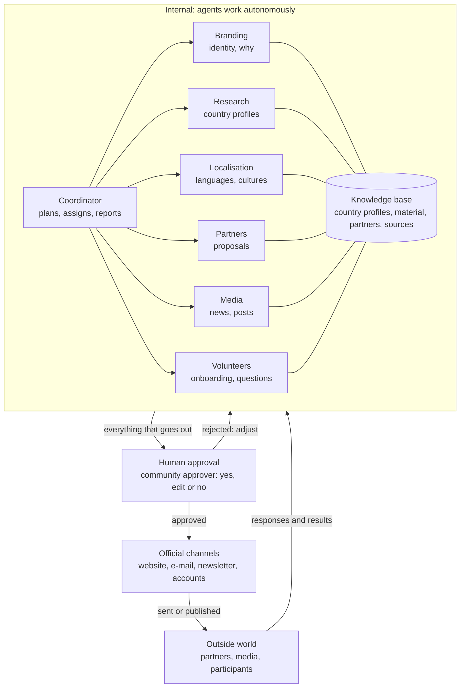

# Architecture: the agent system

A small team of AI agents does the preparatory work of the campaign autonomously; everything that goes out is approved by a human first.

## At a glance

The agents work around one knowledge base; everything that goes out passes a human first, and the responses steer the next round.

## The agents

Nine agents, each with one clear task. The orchestrator starts them by plain rules; the coordinator reports on the whole.

| Agent | Task | Delivers | Autonomy |
| --- | --- | --- | --- |
| Coordinator | Plans the work, sets priorities, tracks progress | Task list, weekly report for the maintainers | Fully internal |
| Branding | Develops the brand identity and the "why" from the manifesto | Brand guide, colour palette, typography, logo proposals, short texts | Published only after approval |
| Designer | Makes posters, social cards, illustrations and icons from design briefs | SVG artwork in `design/` | Published only after approval |
| Web builder | Designs and builds the website's look and layout with the brand and artwork | Stylesheet and templates in `site/` | Published only after approval; the site must build first |
| Research | Collects per country the retirement age, the age of the highest office holders, the political system, election dates | Country profiles with sources | Fully internal |
| Localisation | Translates and adapts the manifesto, posters and texts per language and culture | Campaign material per country | Fully internal |
| Partners | Finds organisations per country that fit and drafts a tailored proposal | Partner list + draft e-mails | Sent only after approval |
| Media | Follows the news on the age of leaders, proposes responses and press releases | Draft posts, op-eds, press releases | Published only after approval |
| Volunteers | Welcomes participants, answers questions in their language, helps chapters get started | Answers, starter kits | Standard answers autonomous; anything unusual goes to a human |

## Approval flow

The rule is simple: **internal work is autonomous; everything that goes out passes a human.**

1. An agent makes a proposal (e-mail, post, press release, partner contact).
2. The proposal enters the **approval queue** as a GitHub pull request, with context: for whom, why, based on which sources.
3. A community approver, per country or language, approves (merges), edits or rejects (closes) it. Sensitive messages (press releases, contact with large organisations) need two approvers.
4. Only after approval does the system send or publish it, through the movement's official channel.
5. The response (reply, reach, signatures) goes back to the coordinator, which adjusts the next plan.

Rejections and edits are kept. They are used to regularly refine the agents' instructions, so they match the movement's voice and limits ever more closely.

## Technical building blocks

| Layer | Implementation | Note |
| --- | --- | --- |
| Language model | Claude via the API | One model for all agents, each with its own instructions and tools |
| Orchestration | Claude Agent SDK | The coordinator starts the other agents as subagents and assigns the work |
| Orchestration rules | `agents/orchestrator.py`, every six hours and after each merge | Plain rules, no AI: starts agents with work to do, waits for open PRs, daily run budget, pause switch |
| Knowledge base | Database with country profiles, material, partners, decisions | Single source of truth for all agents |
| Approval queue | GitHub pull requests, branch protection | Merge = approve; two required reviews for sensitive paths; full history |
| Runtime | GitHub Actions | Agents start on a schedule or by hand; no server to host |
| Website | Manifesto, sign-up, digital baton, world map | Multilingual, fed by the localisation agent |
| Channels | Official e-mail, newsletter, the movement's accounts | Approved messages only |
| Monitoring | Costs, errors, reach | Budget cap per agent per month |

## Limits and safeguards

The movement's credibility is its most important asset. These rules therefore live in the system itself, not only in good intentions.

- **No fake voices.** Agents never create accounts and never pose as ordinary citizens.
- **Always identifiable.** Every message comes from an official sender of the movement. Where AI helped write, we say so.
- **No mass messaging.** Only targeted, personal contact with organisations; no unsolicited bulk mail.
- **Sources required.** Every fact about a country or leader has a source in the knowledge base. No source, no publication.
- **Privacy.** Personal data of signatories and volunteers is handled under the GDPR and used only for the movement.
- **Care in authoritarian countries.** Participants there can face real risk. Show no names or locations; make anonymous participation possible.
- **Emergency stop.** The maintainers can pause all agents with one switch.

## Phasing

Start small; expand only once each step works.

1. **Identity and website.** Branding agent: brand guide, colours, typography, logo proposals, the "why" in short texts. A simple website with the manifesto.
2. **Facts and languages.** Research and localisation agents. Result: country profiles and the manifesto in the first languages, added to the website.
3. **Reach.** Partner and media agents added, always with prior approval.
4. **Scale.** Volunteer agent and coordinator, sign-up and digital baton. Local chapters start independently with the starter kit.
5. **Second line.** Extending the demand to other political offices, with the same machine.

## Open source and community

The movement's machine is itself open: anyone can see what the agents do, propose improvements or run a local version.

- **Public code.** Everything in one public repository: agents and their instructions, website, approval screen.
- **Copyleft licence.** AGPL-3.0, so modified versions stay open and no one can lock the machine away or take it over commercially.
- **Local versions.** A chapter can adopt the code and adapt it to its language and country, with the same safeguards.
- **Contributors.** A short guide to contributing, a list of good first issues and open discussion about direction.
- **Community approvers.** Per country or language, after a short trial period. Two approvers for sensitive messages, as protection against sabotage from within.
- **No secrets.** Only keys, passwords and personal data stay protected; everything else is public.

## Funding

The movement funds itself mainly by selling physical batons; taking part always stays free.

- **Physical batons.** Each baton has a unique code or QR. Scanning it shows where it came from and passes it on digitally. Every baton sold becomes a link in the chain.
- **Digital baton free.** Signing and passing it on never costs money, so no one is excluded.
- **Made locally.** Batons made per country or region by local makers or social workshops: less transport, more local support.
- **Low costs.** Build it ourselves, open source, a budget cap per agent, expensive agents only once there is support.
- **Fully transparent.** A public page shows what comes in and where it goes: API costs, hosting, actions.
- **Legal entity needed.** As soon as money comes in, bookkeeping, VAT and a bank account are required. Proposal: start as an unincorporated association, later an international non-profit. To be checked legally.
